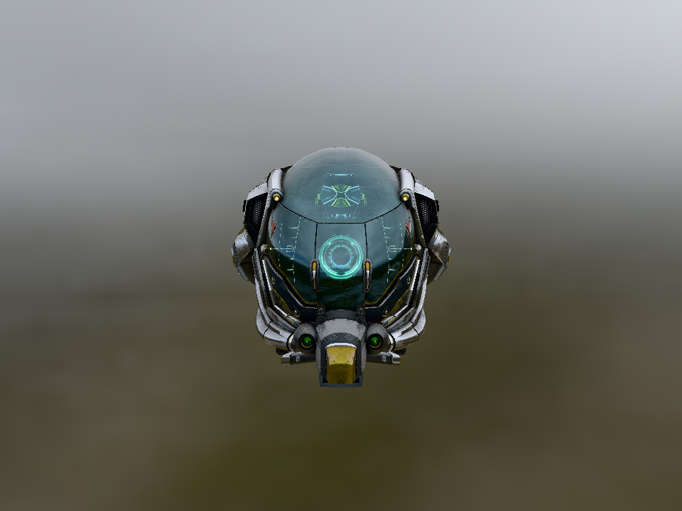
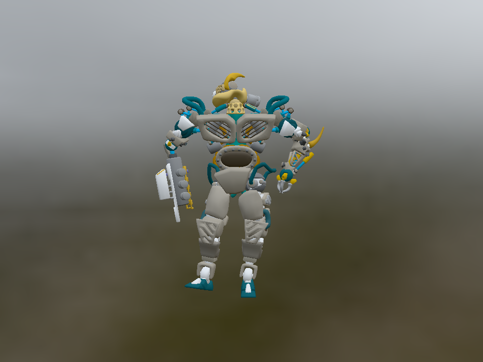

# NeoCogi Platform

A Rust workspace for native/browser platform services, portable GPU resources,
scoped graphics commands, shader compilation and backend execution. Public APIs
use typed COM interfaces. Applications can use graphics directly or combine it
with [NeoCogi UI](https://github.com/NeoCogi/neocogi-ui).

## Workspace

| Package | Responsibility |
| --- | --- |
| `crates/platform-contracts` (`neocogi-platform-contracts`) | Schemas, generated bindings, shared types, limits, validation and build support |
| `crates/platform` (`neocogi-platform`) | GPU recording/backends, renderer-owned compiler and optional hosting |
| `crates/platform-dylib` (`neocogi-platform-dylib`) | Thin platform shared-library entrypoints including the renderer compiler |
| `examples/native`, `tests/*` | Unpublished application and acceptance consumers |
| `scripts` (`neocogi-platform-tools`) | Unpublished Rust development and qualification tools, run with `cargo tools` |

Platform and graphics implementations share native lifetime ownership. Native
windows, SDL/DOM objects and API handles remain private; callers receive typed
capabilities. The renderer accepts sealed generic commands and has no widget,
theme, camera, material or mesh model.

## Build and run

The checked-in toolchain selects the required nightly, standard-library sources
and WebAssembly target. Native builds require SDL2 development libraries; Vulkan
also needs the Vulkan loader. On Debian/Ubuntu these are `libsdl2-dev` and
`libvulkan-dev`. A native display or an appropriate software driver is needed
for execution.

Fetch dependencies first: some tests inspect every backend and the browser target
without network access, even when those dependencies are not used by the current build.

```sh
cargo fetch --locked
cargo check --locked --workspace --all-targets
cargo test --locked -p neocogi-platform-contracts --features build-support
cargo test --locked -p neocogi-platform --features platform,glow,test-support
cargo run --locked -p neocogi-platform-examples --bin triangle -- 3
```

For headless native GL qualification:

```sh
SDL_VIDEODRIVER=offscreen cargo run --locked -p neocogi-platform-examples --bin triangle -- 3
SDL_VIDEODRIVER=offscreen cargo test --locked -p neocogi-platform --features platform,glow,test-support --lib -- --include-ignored --test-threads=1
```

The SDK has empty default features. Native GPU features `glow`, `vulkan` and
`wgpu` are additive under `neocogi_platform::gpu::backends`. Enable `platform`
with exactly one backend for SDL hosting. Build scripts depend on
`neocogi-platform-contracts` with `build-support` for generation/resource staging.
Dynamic clients use its shared types without depending on the SDK.
Browser hosting uses `platform,webgl` and `wasm32-unknown-unknown`.
CPU-only consumers need no SDL, graphics loader or compiler implementation.
Shader output is fixed by each renderer: WGPU uses WGSL, Vulkan uses SPIR-V and
GLES3/WebGL uses ES300. Backends enable their compiler and `shader-wgsl`, `shader-spirv` or
`shader-glsl`; standalone compilers select these without graphics dependencies.

Native examples select `static,glow` by default. Use `--no-default-features
--features static,vulkan` or `static,wgpu` for alternatives. For dynamic assembly,
first run `cargo build -p neocogi-platform-dylib --no-default-features --features glow --examples` (or vulkan/wgpu),
then select only `dynamic` in the application. It discovers the sole deployed
platform library; use `-- --backend vulkan` (or glow/wgpu) when several are present. Pass the same
`--profile` to both commands; min-size runs require preparing `--profile min-size`. Normal Rust
applications link the SDK; final shared-library shims expose the existing COM ABI.

The native glTF examples include a textured DamagedHelmet and animated GPU-skinned
BrainStem, both with arcball rotation, pan and zoom.
Both use Cannon Exterior HDR lighting, filtered reflections and a skybox.

| Damaged Helmet | BrainStem |
| :---: | :---: |
|  |  |

Captured from the examples using the Glow backend. Damaged Helmet is by
theblueturtle_ and ctxwing ([license](examples/native/gltf/DamagedHelmet-LICENSE.md));
BrainStem is by Keith Hunter, © Smith Micro Software, Inc.
([license](examples/native/gltf/BrainStem-LICENSE.md)). The Cannon Exterior environment
is by Greg Zaal ([CC0](examples/native/gltf/Cannon_Exterior-LICENSE.md)).

```sh
cargo tools fetch-gltf-examples
cargo run --locked -p neocogi-platform-examples --bin gltf_damaged_helmet
cargo run --locked -p neocogi-platform-examples --bin gltf_brainstem
```

Load shared shader/platform objects in the examples with:

~~~sh
cargo build --locked -p neocogi-platform-dylib --no-default-features --features glow --examples
cargo run --locked -p neocogi-platform-examples --bin gltf_brainstem --no-default-features --features dynamic
~~~

The application build stages the prebuilt platform library, which includes its
renderer-owned compiler. Requests carry no shader target; results identify it for
backend validation. See [native assembly and relocation](examples/native/README.md).

Left-drag rotates, right/middle-drag pans, and the wheel zooms. Press R to reset,
Space to pause animation, B to toggle the skybox, or Escape to close. See the [example guide](examples/native/gltf/README.md)
for backend selection, bounded headless runs, supported glTF features and asset licenses.

The Platform and UI workspaces currently pin the published COM, host and IDL
packages to exact `0.1.0`. Shared dependencies participate in one application Cargo graph.
Independent builds can reuse compatible artifacts through `CARGO_TARGET_DIR`.

See [documentation](docs/README.md), [component ownership](docs/architecture/COMPONENTS.md),
[GPU contracts](docs/contracts/GPU_RENDERING.md), [shader compilation](docs/contracts/SHADER_COMPILATION.md),
and [dependency compatibility and revision history](docs/project/HISTORY.md).

The current release target is `0.1.0-alpha.2`. See [release preparation](docs/project/RELEASING.md)
for the published package set, self-contained build inputs and verification.

Asset downloads, package qualification, browser tests and local debugging helpers
are Rust commands. See [repository tools](scripts/README.md); no Python interpreter
is required.
