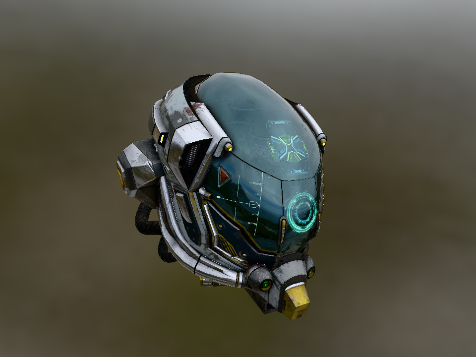
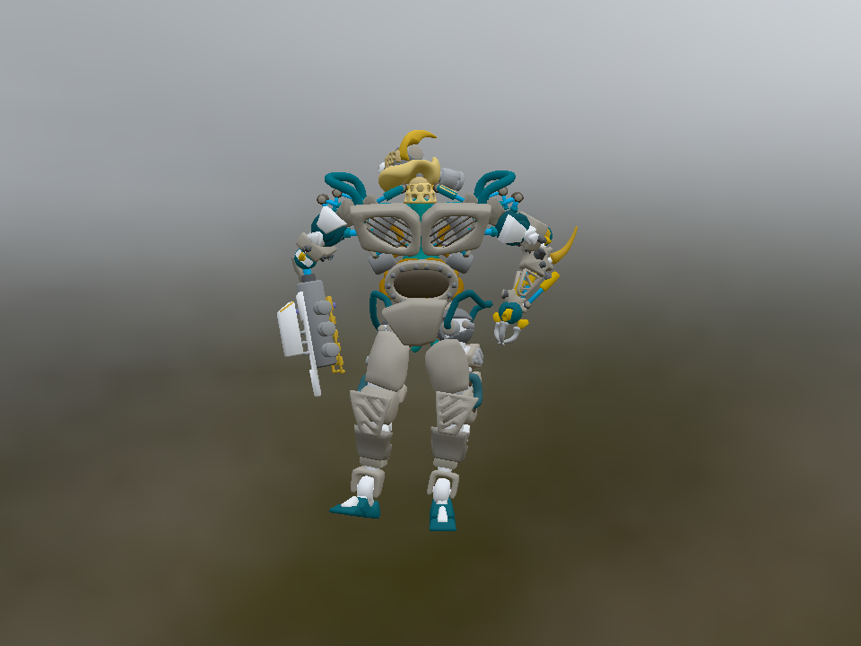

# NeoCogi Platform shared-library shim

One normal Cargo `cdylib` named `nc_platform`, containing the selected renderer,
its built-in COM shader compiler and audio services. The sole discovery export is
`nc_get_plugin_descriptor_v2`. The executable owns the COM host; this library uses
its supplied services. Static Rust applications use `neocogi-platform` instead.

## Rendered examples

| Damaged Helmet | BrainStem |
| :---: | :---: |
|  |  |

Captured from the actual Glow renderer. Damaged Helmet uses a slightly elevated
diagonal camera; BrainStem shows the animated model at its initial pose. Both use
Cannon Exterior HDR lighting, filtered reflections and a skybox.

Damaged Helmet: theblueturtle_ and ctxwing ([license](docs/licenses/DamagedHelmet-LICENSE.md)).
BrainStem: Keith Hunter, © Smith Micro Software, Inc.
([license](docs/licenses/BrainStem-LICENSE.md), [Poser EULA](docs/licenses/LicenseRef-Poser-EULA.txt)).
Cannon Exterior: Greg Zaal ([CC0](docs/licenses/Cannon_Exterior-LICENSE.md)).
Images, credits and license notices are included in this crate archive.

## Build the library

From the repository checkout, select exactly one backend and use the same
profile and target for the library and its application:

```sh
cargo build --locked --profile min-size -p neocogi-platform-dylib --no-default-features --features vulkan
```

| Feature | Renderer / shader output |
| --- | --- |
| `glow` (default) | GLES3 / GLSL ES 3.00 |
| `vulkan` | Vulkan / SPIR-V |
| `wgpu` | WGPU / WGSL |
| `shader-python` | Adds the optional Python-like frontend alongside the selected backend |

| System | Output in `target/min-size/` |
| --- | --- |
| Linux | `libnc_platform.so` |
| macOS | `libnc_platform.dylib` |
| Windows | `nc_platform.dll` |

Backend selection changes the implementation and descriptor, never the filename.
S-expressions are built in; no separate compiler plugin or shader library is
needed. Python-like source is disabled by default: add `shader-python` alongside
the backend, for example `--features vulkan,shader-python`.

Native builds need SDL2 development libraries and the selected backend's
driver/loader; Vulkan needs its loader. The repository's `min-size` profile uses
rolling nightly, rebuilt std and immediate-abort panics. The recorded alpha.4
Vulkan library is **418,120 bytes** by default or **459,440 bytes** with Python,
both below 512 KiB. Source-archive screenshots do not enter the native library.

## Build from crates.io

Declare the deployment artifact in a consumer's `Cargo.toml`. Use a separate
build package when the application's graph should contain only contracts:

```toml
[dependencies]
neocogi-platform-dylib = { version = "=0.2.0", default-features = false, features = ["vulkan"] }
```

Then build the dependency's normal library and deploy it:

```sh
cargo build --release -p neocogi-platform-dylib --lib
# Copy target/release/libnc_platform.so into the application's deployed lib directory.
```

This is a deployment artifact, not a Rust API to import. A cdylib-only dependency
may produce a Cargo warning about having no Rust-linkable target; select it with
`-p` as above. Published consumers choose their own profile and toolchain; they
need no checkout-relative build paths or Cargo artifact dependencies.

## Load it from an application

The dynamic host needs the shared contracts and COM host, with no renderer SDK
dependency. For the Vulkan library built above:

```toml
[dependencies]
neocogi-platform-contracts = { version = "=0.2.0", default-features = false }
neocogi-com = { version = "=0.2.0-alpha.4", default-features = false, features = ["std", "runtime"] }
neocogi-com-host = { version = "=0.2.0-alpha.4", default-features = false }
```

```rust
use neocogi_com::{ComPtr, INcBytesComPtrExt, NcCopyFromBufferOffset, Runtime};
use neocogi_platform_contracts::render::{
    abi::{GpuShaderStage, ShaderCompileRequest, ShaderCompilerFactoryAbi, ShaderTarget},
    platform::PlatformAbi,
};

fn main() -> Result<(), Box<dyn std::error::Error>> {
    // SAFETY: This final executable owns the process-lived COM host tables.
    let runtime = unsafe { Runtime::__from_host_api(neocogi_com_host::initialize_process()) }?;
    let library = std::env::args_os().nth(1).expect("pass the trusted platform library path");
    // SAFETY: The application deliberately loads its trusted, matching platform deployment.
    // The host validates the descriptor and pins provider code for process lifetime.
    let id = unsafe { runtime.load_plugin_library(std::path::PathBuf::from(library)) };
    let platform: ComPtr<PlatformAbi> = runtime.acquire_plugin_root(id)?;
    let factory = platform.query::<ShaderCompilerFactoryAbi>()?;
    let compiler = factory.create(ShaderTarget::SpirV)?;
    let source = b"(module (vertex vs () (returns vec4 (builtin position)) (return (vec4 0.0 0.0 0.5 1.0))))";
    let result = compiler.compile(
        ShaderCompileRequest {
            stage: GpuShaderStage::Vertex,
            max_output_bytes: 4 * 1024 * 1024,
        },
        NcCopyFromBufferOffset::new(0, source),
        NcCopyFromBufferOffset::new(0, b"vs"),
    )?;
    println!("Compiled {} SPIR-V bytes", result.code()?.to_vec()?.len());
    Ok(())
}
```

Run the host with the path to its deployed library. The root also provides
windows and audio; QueryInterface obtains the same built-in shader compiler used
by the renderer. Use `GlslEs300` for a Glow library or `Wgsl` for a WGPU library.
Compile failures return owned source-located diagnostics. The target is fixed per
compiler; requests contain only stage and output budget. S-expression and
optional Python-like input share validation and the optimized backend writers.

COM/host/IDL use exact `0.2.0-alpha.4` dependencies. Rebuild providers and generated
consumers together after contract/toolchain changes; compatibility uses derived
identities and exact signatures. Runtime backend selection belongs to the loaded
library. An application's `--backend` option can verify that choice, not replace it.

## Run the repository examples dynamically

These commands run from a checkout. Build the library first; the application's
build script stages it into `target/<profile>/lib/` and stages its assets:

```sh
cargo tools fetch-gltf-examples
cargo build --locked --profile min-size -p neocogi-platform-dylib --no-default-features --features vulkan
cargo run --locked --profile min-size -p neocogi-platform-examples --bin triangle --no-default-features --features dynamic -- --backend vulkan 3
cargo run --locked --profile min-size -p neocogi-platform-examples --bin gltf_damaged_helmet --no-default-features --features dynamic -- --backend vulkan
cargo run --locked --profile min-size -p neocogi-platform-examples --bin gltf_brainstem --no-default-features --features dynamic -- --backend vulkan
```

Deploy each executable with its `lib/` and `assets/` directories. The example
loader resolves them relative to the executable and verifies the descriptor.
Change `vulkan` to `glow` or `wgpu` on the library build and runtime verification;
the dynamic application uses only `dynamic`, without backend Cargo features.
For Python-like Triangle, add `shader-python` to both the library build and the
application's source selection. glTF viewers use S-expressions in either mode.

Left-drag rotates, right/middle-drag pans and the wheel zooms. R resets, B toggles
the skybox, Space pauses animation and Escape closes. Add `--frames 3 --time 1`
to a glTF command for bounded execution at a fixed pose.

See [the native example guide](https://github.com/NeoCogi/neocogi-platform/blob/master/examples/native/README.md),
[shader contracts](https://github.com/NeoCogi/neocogi-platform/blob/master/docs/contracts/SHADER_COMPILATION.md)
and [release qualification](https://github.com/NeoCogi/neocogi-platform/blob/master/docs/project/RELEASING.md)
for the complete staging, ownership and verification workflow.

## Shader execution comparison: limited sample

This fixed snapshot covers only the handful of shaders used by this repository's
Triangle, Damaged Helmet and BrainStem examples. It is a small, non-exhaustive
sample; results apply to these workloads and this hardware, without establishing
general shader-compiler performance.

Measured on 2026-11-12: Intel Arc Meteor Lake, Mesa 26.0.8, Linux 7.0.0-42,
rustc 1.102.0-nightly (`3ef0c22cd`). Both revisions used `min-size`, rebuilt std
and immediate-abort panics. The Naga 30.0.1 implementation is revision `1a27094`;
our optimized S-expression compiler is revision `488291b`. These are historical
measurements of those revisions.

| Backend / output | Example | Naga FPS | Our compiler FPS | FPS change |
| --- | --- | ---: | ---: | ---: |
| Vulkan / SPIR-V | Triangle | 949.4 | 942.4 | -0.7% |
| Vulkan / SPIR-V | Damaged Helmet | 77.8 | 77.9 | ≈0.0% |
| Vulkan / SPIR-V | BrainStem | 82.4 | 83.0 | +0.7% |
| GLES3 / GLSL ES3 | Triangle | 2,830.3 | 2,817.2 | -0.5% |
| GLES3 / GLSL ES3 | Damaged Helmet | 76.1 | 77.7 | +2.1% |
| GLES3 / GLSL ES3 | BrainStem | 74.6 | 75.1 | +0.7% |
| WGPU / WGSL | Triangle | 789.8 | 750.8 | -4.9% |
| WGPU / WGSL | Damaged Helmet | 76.1 | 75.1 | -1.4% |
| WGPU / WGSL | BrainStem | 67.9 | 67.7 | -0.3% |

FPS is 300 divided by the median elapsed time of three alternating runs per
implementation, following 60-frame warmups. Changes are relative to Naga and use
unrounded values. Timing covers the entire application process, including
startup, presentation and teardown, rather than compilation
throughput or isolated GPU time. glTF animation time was fixed at 1, HDR data was
cached, and builds ran separately from measurements. Both implementations used
SDL offscreen rendering for GLES3 and X11 windows for Vulkan/WGPU; compare within
each backend. Short Triangle runs and presentation pacing limit sensitivity to
small differences. WGPU still uses Naga internally for native translation.

[Saved measurements, individual samples and artifact hashes](docs/benchmarks/shader-examples-2026-11-12.json).
See [shader qualification](https://github.com/NeoCogi/neocogi-platform/blob/master/docs/contracts/SHADER_COMPILATION.md#performance-qualification)
and [the profiling tool](https://github.com/NeoCogi/neocogi-platform/blob/master/scripts/README.md) for the current measurement workflow.
