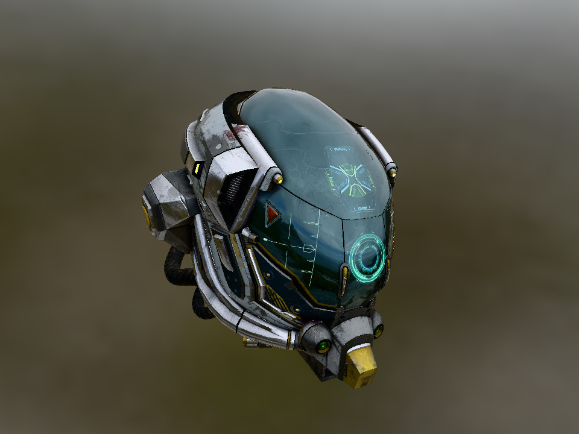
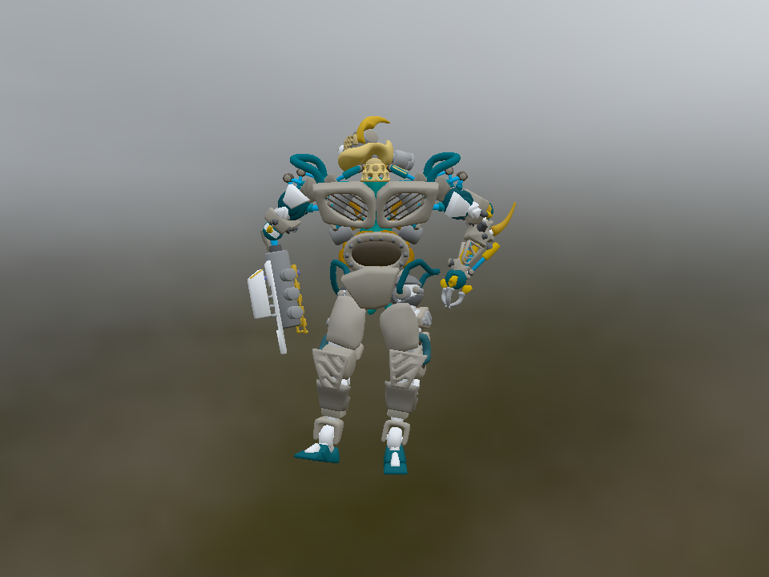

# NeoCogi Platform renderer SDK

Typed COM interfaces for GPU resources, graphics recording, shader compilation,
PCM playback/capture and SDL/browser hosting. Link this crate for a static
implementation. Dynamic applications use `neocogi-platform-contracts` and load
`neocogi-platform-dylib` instead.

## Rendered examples

| Damaged Helmet | BrainStem |
| :---: | :---: |
|  |  |

Captured from the actual Glow renderer. Damaged Helmet uses a slightly elevated
diagonal camera; BrainStem shows the animated model at its initial pose. Both use
Cannon Exterior HDR lighting, filtered reflections and a skybox.

Damaged Helmet: theblueturtle_ and ctxwing ([license](docs/licenses/DamagedHelmet-LICENSE.md)).
BrainStem: Keith Hunter, © Smith Micro Software, Inc.
([license](docs/licenses/BrainStem-LICENSE.md), [Poser EULA](docs/licenses/LicenseRef-Poser-EULA.txt)).
Cannon Exterior: Greg Zaal ([CC0](docs/licenses/Cannon_Exterior-LICENSE.md)).
Images, credits and license notices are included in this crate archive.

## Static Rust integration

Audio, window hosting and shader compilation are built in. **Glow is the default
renderer**, so an ordinary dependency is sufficient:

```toml
[dependencies]
neocogi-platform = "=0.2.0"
neocogi-com = { version = "=0.2.0", default-features = false, features = ["std", "runtime"] }
neocogi-com-host = { version = "=0.2.0", default-features = false }
```

The application owns one COM host, registers the linked platform descriptor, and
acquires its typed root. This complete example compiles a vertex shader through
the built-in COM service without opening a window:

```rust
use neocogi_com::{ComPtr, INcBytesComPtrExt, NcCopyFromBufferOffset, Runtime};
use neocogi_platform::render::{
    abi::{GpuShaderStage, ShaderCompileRequest, ShaderCompilerFactoryAbi, ShaderTarget},
    platform::PlatformAbi,
};

fn main() -> Result<(), Box<dyn std::error::Error>> {
    // SAFETY: This final executable owns the process-lived COM host tables.
    let runtime = unsafe { Runtime::__from_host_api(neocogi_com_host::initialize_process()) }?;
    let descriptor = neocogi_platform::platform::plugin_descriptor();
    // SAFETY: The complete descriptor and implementation stay linked for process lifetime.
    unsafe { runtime.register_plugin_descriptor(descriptor) }?;
    let platform: ComPtr<PlatformAbi> = runtime.acquire_plugin_root(descriptor.plugin_id)?;
    let factory = platform.query::<ShaderCompilerFactoryAbi>()?;
    let compiler = factory.create(ShaderTarget::GlslEs300)?;
    let source = b"(module (vertex vs () (returns vec4 (builtin position)) (return (vec4 0.0 0.0 0.5 1.0))))";
    let result = compiler.compile(
        ShaderCompileRequest {
            stage: GpuShaderStage::Vertex,
            max_output_bytes: 4 * 1024 * 1024,
        },
        NcCopyFromBufferOffset::new(0, source),
        NcCopyFromBufferOffset::new(0, b"vs"),
    )?;
    println!("Compiled {} GLSL ES3 bytes", result.code()?.to_vec()?.len());
    Ok(())
}
```

For Vulkan or WGPU, replace the SDK dependency with an explicit renderer selection:

```toml
neocogi-platform = { version = "=0.2.0", default-features = false, features = ["vulkan"] }
```

Use `ShaderTarget::SpirV` for Vulkan and `ShaderTarget::Wgsl` for WGPU.
For drawing, use `Platform` to create a window, then acquire its typed surface,
resource-group and recording capabilities. The repository examples below provide
complete input/render loops. Native handles remain inside the provider.

## Feature selection

| Feature | Provides |
| --- | --- |
| `glow` (default) | Native GLES3 and its GLSL ES 3.00 compiler output |
| `vulkan` | Native Vulkan and SPIR-V output |
| `wgpu` | Native WGPU and WGSL output |
| `webgl` | Browser WebGL2 and GLSL ES 3.00 output on `wasm32-unknown-unknown` |
| `shader-python` | Optional Python-like source frontend, disabled by default |

Select exactly one renderer. Audio and windowing have no separate feature flags;
audio can be opened without creating a window. Native builds need SDL2 development
libraries and a working graphics driver; Vulkan also needs its loader. Browser
builds use `--no-default-features --features webgl` and the WebAssembly target.

## Built-in shader compiler

S-expressions are built in. `shader-python` adds typed `def` functions,
`@vertex`/`@fragment`, records, indentation and ordinary expressions without a
Python runtime or additional parser dependency. Backends and `test-support` leave
it disabled. See [the Python-like Triangle program](examples/triangle.pysh).

Both frontends share a typed IR, validation, optimization and backend writers.
Parse/type failures report original line/column, an excerpt and a caret. Results
and diagnostics own their exported data and remain valid after compiler release.
Compilation requests contain stage and output budget; the compiler's target is
fixed at construction. The platform root exposes `ShaderCompilerFactory` through
QueryInterface; the renderer retains its own compiler for its backend.

Outputs are UTF-8 WGSL/GLSL or little-endian SPIR-V words through one `code()` byte
buffer. Imports check target, encoding and bounds before retaining typed shader
data. The compiler is always built in, and `shader-python` is its only Cargo
feature. Available writers follow the selected renderer. Compilation can run
without opening a window. Disabling defaults requires selecting a renderer;
zero or multiple renderers are rejected at build time.

## Running the repository examples

Run these commands from the repository checkout; example packages and model files
are separate from this published SDK:

```sh
cargo tools fetch-gltf-examples
cargo run --locked -p neocogi-platform-examples --bin triangle --no-default-features --features static,vulkan -- 3
cargo run --locked -p neocogi-platform-examples --bin gltf_damaged_helmet --no-default-features --features static,vulkan
cargo run --locked -p neocogi-platform-examples --bin gltf_brainstem --no-default-features --features static,vulkan
```

Substitute `glow` or `wgpu` to select another native backend. Left-drag rotates,
right/middle-drag pans, and the wheel zooms; R resets, B toggles the skybox, Space
pauses animation, and Escape closes the window. `--frames 3 --time 1` bounds a
glTF run at a fixed animation pose. Add `shader-python` to use Python-like Triangle.

## Contracts and deployment

`neocogi-platform-contracts` owns the canonical schemas, generated ABI and shared
validation; `render` reexports those exact types. Build scripts depend on that
crate with `build-support` for schema generation and native resource staging.
COM/host/IDL are pinned together to `0.2.0`. Compatibility uses derived
contract identities and signatures: rebuild generated consumers and providers
together after a toolchain or contract change.

Measured complete platform libraries with COM/IDL `0.2.0-alpha.4`, nightly,
rebuilt std and immediate-abort panics:

| Renderer | `min-size` bytes | With `shader-python` |
| --- | ---: | ---: |
| Glow (default) | 473,872 | 515,432 |
| Vulkan | 418,120 | 459,440 |

All four bundles are below 512 KiB. These are complete shared-library sizes,
not the Rust rlib or source archive; documentation images do not enter the binary.
The [shim guide](https://github.com/NeoCogi/neocogi-platform/blob/master/crates/platform-dylib/README.md)
covers dynamic deployment. See [API documentation](https://docs.rs/neocogi-platform),
[the shader contract](https://github.com/NeoCogi/neocogi-platform/blob/master/docs/contracts/SHADER_COMPILATION.md)
and [the native example guide](https://github.com/NeoCogi/neocogi-platform/blob/master/examples/native/README.md)
for the full interfaces, grammar, limits, ownership and execution workflow.

## Shader execution comparison: limited sample

This fixed snapshot covers only the handful of shaders used by this repository's
Triangle, Damaged Helmet and BrainStem examples. It is a small, non-exhaustive
sample; results apply to these workloads and this hardware, without establishing
general shader-compiler performance.

Measured on 2026-11-12: Intel Arc Meteor Lake, Mesa 26.0.8, Linux 7.0.0-42,
rustc 1.102.0-nightly (`3ef0c22cd`). Both revisions used `min-size`, rebuilt std
and immediate-abort panics. The Naga 30.0.1 implementation is revision `1a27094`;
our optimized S-expression compiler is revision `488291b`. These are historical
measurements of those revisions.

| Backend / output | Example | Naga FPS | Our compiler FPS | FPS change |
| --- | --- | ---: | ---: | ---: |
| Vulkan / SPIR-V | Triangle | 949.4 | 942.4 | -0.7% |
| Vulkan / SPIR-V | Damaged Helmet | 77.8 | 77.9 | ≈0.0% |
| Vulkan / SPIR-V | BrainStem | 82.4 | 83.0 | +0.7% |
| GLES3 / GLSL ES3 | Triangle | 2,830.3 | 2,817.2 | -0.5% |
| GLES3 / GLSL ES3 | Damaged Helmet | 76.1 | 77.7 | +2.1% |
| GLES3 / GLSL ES3 | BrainStem | 74.6 | 75.1 | +0.7% |
| WGPU / WGSL | Triangle | 789.8 | 750.8 | -4.9% |
| WGPU / WGSL | Damaged Helmet | 76.1 | 75.1 | -1.4% |
| WGPU / WGSL | BrainStem | 67.9 | 67.7 | -0.3% |

FPS is 300 divided by the median elapsed time of three alternating runs per
implementation, following 60-frame warmups. Changes are relative to Naga and use
unrounded values. Timing covers the entire application process, including
startup, presentation and teardown, rather than compilation
throughput or isolated GPU time. glTF animation time was fixed at 1, HDR data was
cached, and builds ran separately from measurements. Both implementations used
SDL offscreen rendering for GLES3 and X11 windows for Vulkan/WGPU; compare within
each backend. Short Triangle runs and presentation pacing limit sensitivity to
small differences. WGPU still uses Naga internally for native translation.

[Saved measurements, individual samples and artifact hashes](docs/benchmarks/shader-examples-2026-11-12.json).
See [shader qualification](https://github.com/NeoCogi/neocogi-platform/blob/master/docs/contracts/SHADER_COMPILATION.md#performance-qualification)
and [the profiling tool](https://github.com/NeoCogi/neocogi-platform/blob/master/scripts/README.md) for the current measurement workflow.
